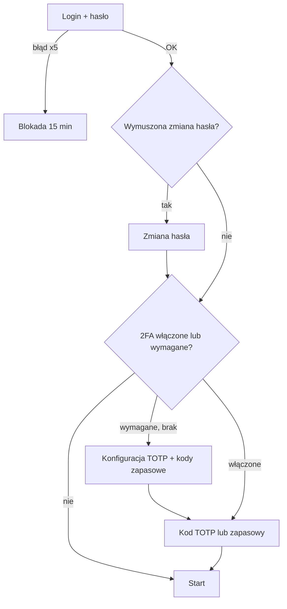
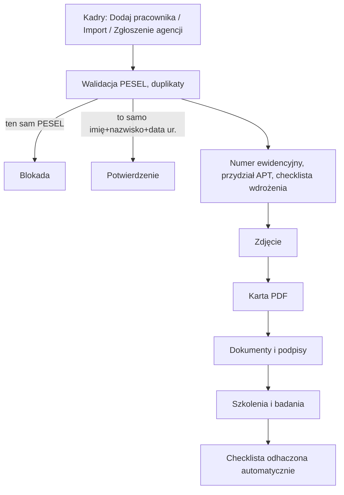
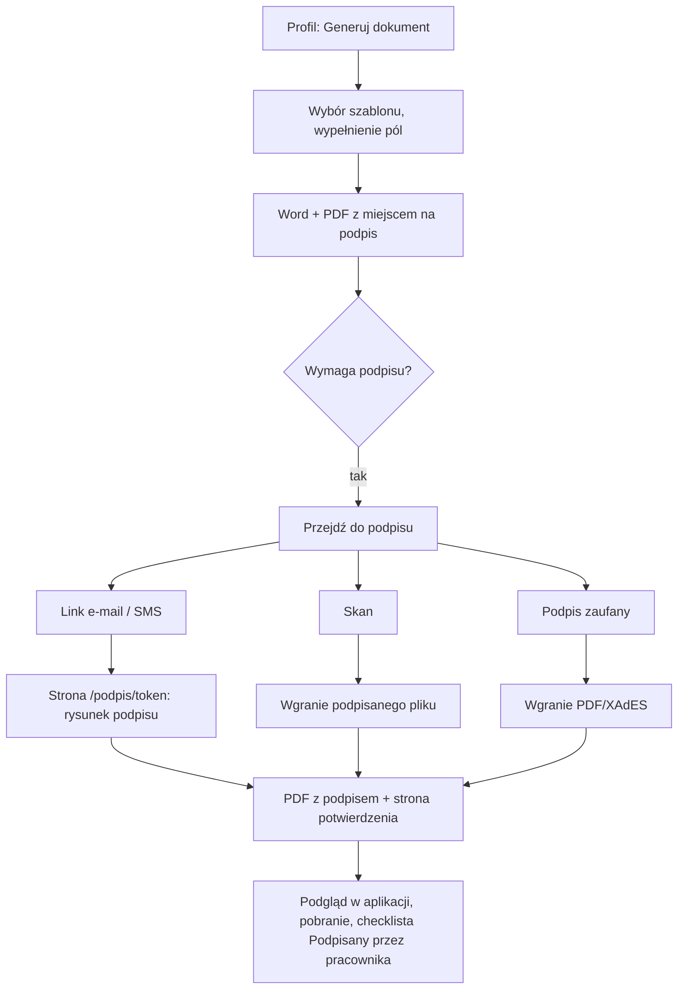
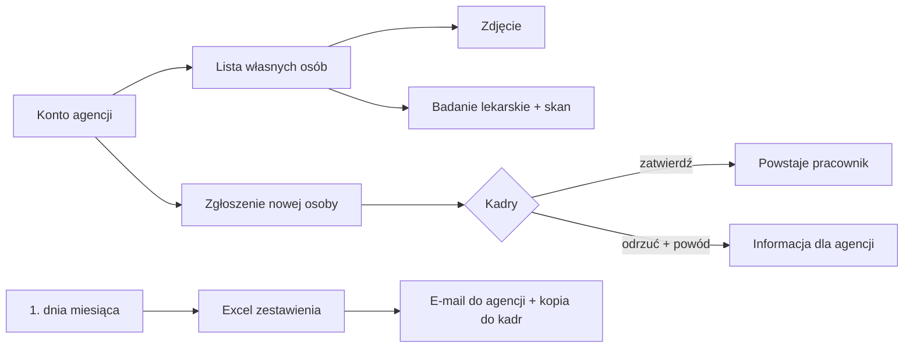

# 3. Przepływy aplikacji (App flow)

## Mapa ekranów

| Ścieżka | Ekran | Role |
|---|---|---|
| `/login`, `/reset-hasla`, `/ustaw-haslo`, `/zmiana-hasla`, MFA | logowanie i hasło | wszyscy |
| `/` | Start: liczniki, najbliższe 14 dni, szybkie akcje | wszyscy |
| `/pracownicy` | lista z filtrami, druk kart, dokument zbiorczy, Excel | wszyscy (zakres wg roli) |
| `/pracownicy/nowy` | nowy pracownik | admin, kadry |
| `/pracownicy/:id/edycja` | edycja | admin, kadry, kierownik (w swoim zakresie) |
| `/pracownicy/:id` | profil: dane, zdjęcie, dokumenty, szkolenia, badania, checklisty, historia | wg roli |
| `/pracownicy/import` | kreator importu | admin, kadry |
| `/skaner` | skaner kodów QR | wg roli |
| `/szablony`, `/szablony/:id` | szablony dokumentów | admin |
| `/slowniki` | APT, wydziały, stanowiska, checklisty | admin, kadry |
| `/szkolenia`, `/braki` | szkolenia i braki | admin, kadry, kierownik |
| `/szkolenia/import` | import szkoleń | admin, kadry |
| `/zadania` | zadania do zrobienia | admin, kadry, kierownik |
| `/raporty` | raporty | admin, kadry, kierownik |
| `/zestawienia` | zestawienia osób dla agencji | admin, kadry, agencja |
| `/zgloszenia` | zgłoszenia nowych osób od agencji | admin, kadry, agencja |
| `/retencja` | trwałe usuwanie po terminie | admin |
| `/dziennik` | dziennik zdarzeń | admin |
| `/uzytkownicy`, `/wylaczeni` | konta | admin |
| `/podpis/:token` | publiczna strona podpisu (bez logowania) | osoba podpisująca |

## 1. Logowanie

## 2. Nowy pracownik

## 3. Dokument i podpis

Skan jest zablokowany, gdy dokument ma podpis elektroniczny. Podpis można usunąć (trwale). Kierownik nie pobiera.

## 4. Agencja pracy

## 5. Zmiana przydziału i zwolnienie

1. Zmiana APT / wydziału / stanowiska: od zaraz albo planowana na datę → wpis w `assignments`.
2. Zwolnienie: status `terminated`, data, checklista odejścia, osoba trafia do archiwum.
3. Ponowne zatrudnienie: stary okres do `employment_periods`, nowy przydział.
4. Po 10 latach (koniec roku): przypomnienie dla admina → trwałe usunięcie z potwierdzeniem „USUŃ”.

## 6. Dzienne zadanie (cron)

Uruchamiane po kopii zapasowej (`deploy/backup.sh` → `app.cli notify-daily`): planowane zmiany na dziś → w poniedziałki
przypomnienia o jakości danych i szkoleniach → 1. dnia miesiąca zestawienia dla agencji → e-mail do administratorów,
jeśli kopia się nie udała lub są dane do usunięcia.

## 7. Symulacja uprawnień

Administrator: menu konta → wybór roli (wydział kierownika albo APT agencji) → cały interfejs i API pokazują tylko to,
co widziałaby ta rola; baner z możliwością powrotu.
