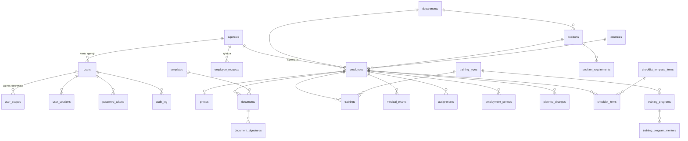

# 5. Schemat backendu i bazy danych

Źródło prawdy: `backend/app/models.py` i migracje `backend/alembic/versions/0001`–`0026`. Baza: PostgreSQL 16.

## Diagram relacji

## Tabele

### Dostęp i bezpieczeństwo

| Tabela | Najważniejsze kolumny | Uwagi |
|---|---|---|
| `webauthn_credentials`, `webauthn_challenges` | klucze dostępu (id poświadczenia, klucz publiczny, licznik) i jednorazowe wyzwania (5 min) | logowanie bez hasła |
| `users` | username (unik.), full_name, email (unik.), role (`admin/hr/manager/viewer/agency/employee`), employee_id (konto pracownika, unik.), password_hash (`!…` = konto bez hasła), is_active, agency_id, failed_login_count, locked_until, totp_secret_enc, totp_enabled_at, totp_last_step, recovery_codes (JSONB) | sekret TOTP zaszyfrowany |
| `user_scopes` | user_id, department_id (kolumna agency_id została, ale nie jest już używana – migracja 0021 usunęła wpisy APT) | zakres kierownika tylko wydziałowy |
| `user_sessions` | id (UUID), token_hash (unik.), csrf_token, expires_at, revoked_at, mfa_pending, ip, user_agent, sim_role, sim_agency_id, sim_department_id | w bazie tylko skrót tokenu |
| `password_tokens` | user_id, token_hash, purpose (`reset/invite`), expires_at, used_at | jednorazowe |
| `audit_log` | id, ts, user_id, username, action, entity_type, entity_id, ip, user_agent, details (JSONB) | UPDATE/DELETE zablokowane wyzwalaczem |

### Słowniki

| Tabela | Kolumny |
|---|---|
| `agencies` | code, name (unik.), is_active, **email** (adresy zestawienia po przecinku) |
| `departments` | code, name (unik.), is_active |
| `positions` | name, department_id, is_active; unik. (name, department_id) |
| `countries` | name, iso_code |

### Kartoteka

| Tabela | Kolumny | Uwagi |
|---|---|---|
| `employees` | number (sekwencja `employee_number_seq`, unik.), first_name, last_name, sex (K/M), birth_date, **pesel_enc**, **pesel_hash** (unik. częściowy), pesel_last2, country_id, agency_id, department_id, position_id, hire_date, termination_date, status (`active/terminated`), notes, retention_hold_until, retention_hold_reason | indeks (last_name, first_name) |
| `photos` | employee_id (unik.), file_name, content_type, size, width, height | plik na dysku |
| `assignments` | employee_id, valid_from, agency_name, department_name, position_name, reason, changed_by_name | nazwy zapisane na chwilę zmiany |
| `employment_periods` | employee_id, hire_date, termination_date, agency_name, department_name, position_name | wcześniejsze okresy |
| `planned_changes` | employee_id, effective_date, changes (JSONB), applied_at, cancelled_at | stosowane w zadaniu dziennym |

### Dokumenty i podpisy

| Tabela | Kolumny | Uwagi |
|---|---|---|
| `templates` | name (unik.), version, file_name, variables, fields (JSONB), sensitive, allow_manager, download_formats, **strict_pdf** (tryb ścisły podpisu), is_active | pliki `templates/<id>_v<wersja>.docx` |
| `documents` | id (UUID), employee_id, template_id, template_name, template_version, has_pdf, contains_sensitive, signature_roles (JSONB), signed_at, has_signed_pdf, created_by_name | pliki `documents/<employee_id>/<id>.*` |
| `document_signatures` | document_id, role, status (`pending/signed/cancelled`), token_hash (unik.), expires_at, channel (`email/sms/link/skan`), sent_to, signer_name, method (`ekran/zaufany/skan`), file_name, failed_attempts, ip, user_agent, signed_at, **device_check**, device_challenge, device_credential, device_verified_at (potwierdzenie blokadą urządzenia), **check_result** (JSONB: wynik weryfikacji pliku z podpisem) | pliki `<document_id>_sig_<id>.*` |

### Szkolenia

| Tabela | Kolumny |
|---|---|
| `training_types` | name, kind (`general/position`), validity_months, fields (JSONB), template_id |
| `training_programs` | type_id, name, department_id, standard_days; unik. (type, name, dział) |
| `training_program_mentors` | program_id, employee_id (klucz złożony) |
| `trainings` | employee_id, type_id, program_id, name, department_id, start_date, exam_date, end_date, completed_on, valid_until, mentor_id, standard_days, values (JSONB), scan_* |
| `position_requirements` | position_id, type_id, program_id; unik. trójka |

### Cykl życia i agencje

| Tabela | Kolumny |
|---|---|
| `checklist_template_items` | kind (`onboarding/offboarding`), label, responsible (`hr/manager`), due_days, auto, sort, agency_ids, department_ids |
| `checklist_items` | employee_id, template_item_id, label, due_date, auto, done_at, done_by_name, skipped, note |
| `medical_exams` | employee_id, kind (`wstepne/okresowe/kontrolne`), exam_date, valid_until, file_name, original_name, notes, created_by_name |
| `employee_requests` | agency_id, first_name, last_name, pesel_enc, country_id, department_id, position_id, hire_date, notes, status (`pending/approved/rejected`), decided_by_name, decided_at, reject_reason, employee_id |

## Pliki na dysku (`APT_DATA_DIR`)

`photos/`, `templates/`, `documents/<employee_id>/`, `trainings/<employee_id>/`, `medical/<employee_id>/`.
Pliki w `photos/`, `documents/`, `trainings/` i `medical/` są zaszyfrowane (AES-256-GCM, klucz z `APT_DATA_KEY`); szablony jawne.
Kopie zapasowe obejmują bazę (`baza.dump`) i pliki (`pliki.tar.gz`).

## Moduły API (FastAPI, prefiks `/api`)

| Router | Zakres |
|---|---|
| `auth` | logowanie, MFA, hasło, symulacja ról (`POST /auth/simulate`) |
| `users` | konta, zakresy, reset 2FA |
| `dictionaries` | APT, wydziały, stanowiska, kraje |
| `employees` | kartoteka, zdjęcia, historia, eksport Excel |
| `imports` | kreator importu |
| `cards` | PDF kart |
| `documents` | szablony, generowanie, podgląd (`/preview/{page}`), pobranie, usuwanie |
| `signatures` | prośby o podpis, strona publiczna, skan, usunięcie podpisu |
| `trainings`, `competence`, `training_import` | szkolenia, katalog, wymagania, braki |
| `lifecycle` | przydziały, planowane zmiany, checklisty |
| `agency_reports`, `agency_portal` | zestawienia, badania lekarskie, zgłoszenia |
| `dashboard`, `reports`, `quality` | Start, raporty, jakość danych |
| `retention`, `audit_log` | retencja, dziennik |

Dokumentacja interaktywna: `/api/docs` (Swagger).

## Zasady modelowania

- Nazwy w historii (`assignments`, `employment_periods`) są kopiami tekstu, żeby zmiana słownika nie przepisała przeszłości.
- Dane osobowe w historii zmian: zapisujemy tylko fakt zmiany pola, nie wartość.
- Usunięcie pracownika kasuje kaskadą zdjęcia, dokumenty, szkolenia, badania, przydziały i checklisty.
- Migracje są liniowe; każda zmiana modelu = nowa migracja Alembic (`alembic upgrade head` robi `aptid-aktualizuj`).

## Wiadomości do kadr (migracja 0028)

- `hr_threads` – wątek pracownika: `employee_id`, `subject` (temat z listy), `status` (`new` / `in_progress` / `done`), `created_at`, `updated_at`.
- `hr_messages` – wiadomości wątku: `thread_id`, `from_staff`, `author_id`, `body` (do 2000 znaków), `created_at`. Bez załączników.
